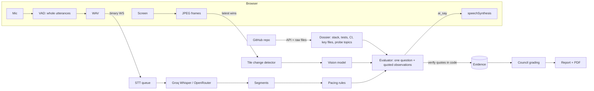

# NavAI Viva

**Repo-grounded project defense interviews.** Nova, an AI examiner, reads a student's GitHub repository, then listens to
and watches their presentation and checks three things against each other: what they **say**, what they **show**, and
what they actually **built**. Every score in the report is tied to a verbatim quote that the server verified.

> Built by Kunal Shaw. v3 is a ground-up rebuild of the original NavAI interviewer (see [What changed from v2](#what-changed-from-v2)).

---

## Why this exists

Written work is no longer a reliable signal of understanding. NYU Stern's AI/ML course found that polished take-home
work did not match what students could explain aloud, and moved to AI-run oral exams: 36 exams cost about \$15 in
direct usage ([arXiv 2603.18221](https://arxiv.org/abs/2603.18221), self-reported, two cohorts, one institution).

Bootcamps, colleges and hackathon organizers have the same problem at larger scale and with less money: nobody can read
every repository or sit through every demo. NavAI Viva is the free-tier-friendly version of that oral defense, built
around a student's **own project**:

| Pain | What NavAI Viva does |
|---|---|
| Can't tell whether the student built it | Asks about specifics found in *their* repo (stack, files, tests) |
| Slides overclaim ("we use Redis + Kafka") | Flags tools that are said or drawn but have no trace in the repository, and asks about them |
| LLM scores are vibes | A score exists only if the model quotes the presenter verbatim and code finds that quote in the transcript or on screen |
| One model's opinion | A council of up to three different model families grades only observed dimensions; disagreement raises a human-review flag |
| Accent / language bias | Utterance-level Whisper with your repo's stack names as a recogniser hint; English, Hindi or Hinglish |
| Confident-sounding fake reports | Missing evidence is reported as "not observed", never a default 5 or 50 |

## How it works



* **Receive loop never blocks.** The WebSocket handler only enqueues; STT, vision and the interviewer run as workers
  (`backend/app/session.py`). "End interview" is handled immediately.
* **Turn taking is rule-based and tested** (`pacing.py`): pauses under 2.5 s are thinking time; the AI waits for enough
  content, a slide change, an invitation ("any questions?") or a long monologue; one question at a time, validated in code.
* **The browser does voice-activity detection**, so the server transcribes whole utterances instead of arbitrary 3-second
  windows, and silence is never sent or billed.
* **The browser speaks** (Web Speech API) and reports real playback start/end, so the server knows when Nova is talking.
  Half-duplex by default (the mic is ignored while Nova talks); a "headphones mode" enables interruption.
* **No fake fallbacks.** If every provider for a step fails, the user sees which provider failed and why.

## Providers (verified 2026-10-10)

| Need | Provider | Notes |
|---|---|---|
| Interviewer (live) | Groq `openai/gpt-oss-20b` → Ollama Cloud `gemma4:31b` → OpenRouter `google/gemma-4-31b-it:free` | all OpenAI-compatible `/chat/completions` |
| Vision | Ollama Cloud `gemma4:31b` → OpenRouter free `google/gemma-4-31b-it:free` → `kimi-k2.6` | Groq's model list currently shows no vision model |
| Grading council | Ollama Cloud `gpt-oss:120b`, `gemma4:31b`, `glm-5.3-flash` (+ Groq `openai/gpt-oss-120b`) | up to `COUNCIL_SIZE` distinct models in parallel |
| Speech-to-text | Groq `whisper-large-v3-turbo` → OpenRouter `openai/whisper-large-v3-turbo` | **Ollama has no STT endpoint** (none in its OpenAI-compatible API docs; `gemma4` audio input is documented only for the small checkpoints, while the cloud tag list shows 31B) |

The previous defaults (`llama-4-scout-17b-16e-instruct`, `llama-3.1-8b-instant`, `llama-3.3-70b-versatile`) are listed on
[Groq's deprecation page](https://console.groq.com/docs/deprecations) with shutdown dates of 2026-07-17 and 2026-08-16.

Model ids and limits change. After setting keys, run:

```bash
cd backend && python scripts/provider_check.py
```

It makes one tiny call per configured model (including a vision call on a generated slide and a one-second STT call)
and tells you which entries work and what to change in `.env`.

## Quick start

Requirements: Python 3.10+ (test suite run on 3.10 and 3.13), Node 20+.

```bash
git clone https://github.com/KUNALSHAWW/AI-Automated-Interviewer.git
cd AI-Automated-Interviewer/backend
python -m venv .venv && source .venv/bin/activate      # Windows: .venv\Scripts\activate
pip install -r requirements.txt
cp .env.example .env                                   # add OLLAMA_API_KEY and/or GROQ_API_KEY
python scripts/provider_check.py                       # confirm your keys and models
python server.py                                       # http://127.0.0.1:8000

# second terminal, for the Vite dev server with hot reload
cd frontend && npm install && npm run dev              # http://localhost:3000
```

Windows users can run `start-backend.bat` and `start-frontend.bat`.

**Docker / Render** (one container serves API, WebSocket and the built app):

```bash
docker build -t navai-viva . && docker run --rm -p 8000:8000 --env-file backend/.env navai-viva
```

`render.yaml` is a blueprint for a free Render web service. Free instances sleep after 15 minutes and have an
ephemeral disk, so sessions live only while the instance does: download the PDF when you finish.

## Configuration

| Variable | Default | Purpose |
|---|---|---|
| `OLLAMA_API_KEY`, `GROQ_API_KEY`, `OPENROUTER_API_KEY` | | Provider keys (one chat key + one STT key minimum) |
| `LIVE_CHAIN`, `VISION_CHAIN`, `COUNCIL_CHAIN`, `STT_CHAIN` | see `.env.example` | `provider:model` lists, first available wins |
| `GITHUB_TOKEN` | | Optional; 60 → 5000 repo-analysis requests/hour |
| `ACCESS_CODE` | | Require a code to start an interview (set on any public deployment) |
| `RETENTION_DAYS` | 30 | Sessions older than this are deleted at startup |
| `MAX_CONCURRENT_SESSIONS` | 2 | One session can have two requests in flight; Ollama Pro allows three |
| `PAUSE_SECONDS`, `MIN_AI_GAP_SECONDS`, `MIN_WORDS_TO_ASK` | 2.5, 20, 35 | Turn-taking |
| `CORS_ORIGINS` | localhost:3000 | Allow-list (the old server allowed `*`) |

## API

`POST /api/sessions` `{repo_url?, rubric_id | rubric, language: en|hi|auto, consent: true, access_code?}` →
`{id, token, ws_path, repo, rubric, warnings}`. Every later request needs `Authorization: Bearer <token>`.

| Route | Purpose |
|---|---|
| `GET /api/health`, `/api/health/deep` | Readiness, which chains are configured, circuit-breaker state, live pings |
| `GET /api/rubrics` | Built-in rubrics (project viva, hackathon judging, mock interview); custom rubrics via `rubric` |
| `GET /api/sessions/{id}` | Status + report |
| `GET /api/sessions/{id}/report.pdf`, `/thumb/{n}.jpg` | Download PDF / slide thumbnails (`?token=` allowed) |
| `POST /api/sessions/{id}/report` | Regenerate the report from stored evidence |
| `DELETE /api/sessions/{id}` | Delete everything for a session |
| `WS /ws/interview/{id}` | First message `{"type":"auth","token":...}` |

WebSocket, client → server: `start`, `stop`, `text`, `playback {state}`, `interrupt`, `screen_state {active}`, `ping`, and binary
frames (`0x01`+WAV utterance, `0x02`+JPEG). Server → client: `status`, `transcript`, `ai_say`, `evidence`, `flag`, `claims`,
`screen`, `warning`, `screen_lost`, `screen_restored`, `ended`, `report_status`, `report`, `report_error`.

## Report anatomy

Per rubric dimension (0 to 4): final score, number of verified quotes, each grader's score, and the quotes themselves.
Overall band (Emerging / Developing / Proficient / Strong) is only given when at least half of the rubric weight was
observed; otherwise "Not enough evidence". The report also lists tools said/shown but not found in the repo, numeric claims
with no support, consistency flags, slide thumbnails, token and audio usage, and a `needs_human_review` block with reasons.

## Tests

```bash
cd backend && pip install -r requirements-dev.txt && python -m pytest -q     # 46 tests
cd frontend && npm test                                                      # 9 tests
```

What is covered: provider fallback and circuit breaking, JSON-mode rejection, retired-model errors, Whisper hallucination
filtering, pacing rules, the question validator, quote verification, the technology lexicon, the change detector (including
the slide-to-slide case the old threshold missed), grading honesty, repository dossier building, and a full
HTTP → WebSocket → evidence → report → PDF → delete run against a fake provider network, plus regression tests for the old
blocked receive loop and the uncancelled reshare timer.

**Not covered by automation:** live calls to the real providers (run `provider_check.py` with your keys) and real
microphone / screen capture on real browsers.

## Privacy and limits

* Consent is required before a session starts. Audio, screen frames and transcripts go to the providers you configure.
* Sessions are readable only with their secret token, are deletable (`DELETE`), and expire after `RETENTION_DAYS`.
* The report is **advisory feedback**, not a grading or hiring decision. It flags itself when evidence is thin or graders disagree.
* Speech recognition can misread accents and technical terms. Repository checks read a sample (manifests, tree, README, key
  files); "not found" means "worth asking". Only public GitHub repositories are supported.
* PDF text uses a Latin font, so Devanagari quotes appear as `?` in the PDF; the web report and JSON keep them.
* Models can still be wrong. Use the evidence panel, not the band alone.

## What changed from v2

| v2 (Jan 2026) | v3 |
|---|---|
| Three Groq models that have since been shut down; failures returned a canned "score 5" | Provider chains with fallback and circuit breaker; failures are surfaced, never faked |
| Change detector averaged the whole frame (slide changes scored 0.015 to 0.023 vs a 0.10 threshold) | 16×9 tile detector that ignores cursors and waits for the picture to settle |
| Visual quality always 5, tech depth = overall, "proceed" stored as 7, report filled with hardcoded 50s | Rubric-anchored scores that require verified quotes; unobserved dimensions are "not observed" |
| STT → LLM → TTS awaited inside the socket receive loop | Queues and workers; the socket only enqueues |
| Fixed 3 s audio windows, README claimed live streaming and pause detection | Browser VAD sends whole utterances; the README now matches the code |
| `allow_origins=["*"]`, no auth, `/api/reports/*` wildcard glob, guessable timestamp ids | Per-session tokens, CORS allow-list, access code, rate limit, random ids, deletion and retention |
| Interviews saved only if a report was requested; duration wrong | Always saved; duration measured |
| `numpy==1.26.3`, `pillow==10.2.0` (no Python 3.13 wheels) | Range pins; backend suite passes on 3.13 |

## Roadmap

Organizer dashboard (cohort comparison, rubric editor in the UI), private repositories via GitHub OAuth, richer code
grounding (AST-level questions), calibration set of recorded demos with human scores, durable storage on a paid database.

## References

* NYU Stern, *Scalable and Personalized Oral Assessments Using Voice AI*, [arXiv 2603.18221](https://arxiv.org/abs/2603.18221): question stacking, silence-as-thinking-time and council grading lessons applied here.
* Ollama Cloud API: [docs.ollama.com/cloud](https://docs.ollama.com/cloud), OpenAI compatibility: [docs.ollama.com/api/openai-compatibility](https://docs.ollama.com/api/openai-compatibility).
* Groq speech-to-text: [console.groq.com/docs/speech-to-text](https://console.groq.com/docs/speech-to-text). OpenRouter STT: [openrouter.ai/docs/guides/overview/multimodal/stt](https://openrouter.ai/docs/guides/overview/multimodal/stt).

## License

MIT, see [LICENSE](LICENSE). © Kunal Shaw.
